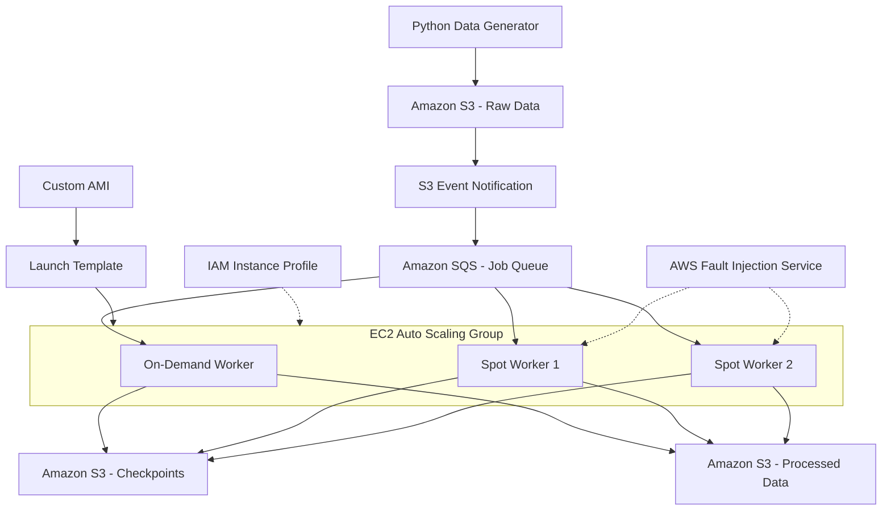
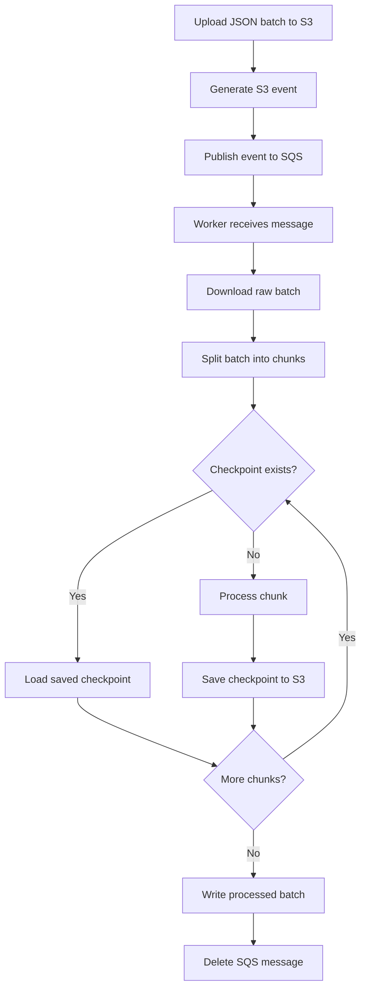
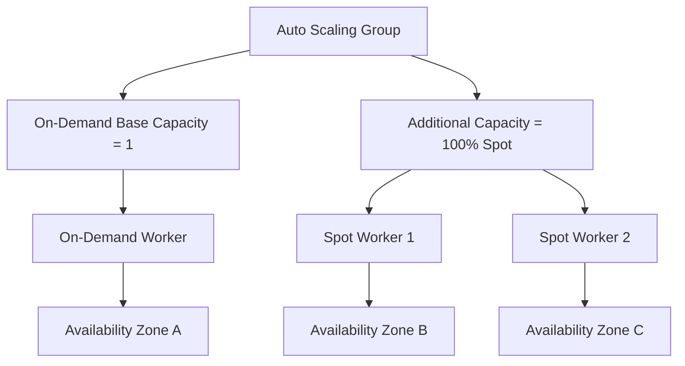
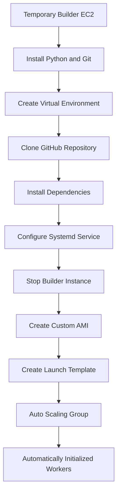
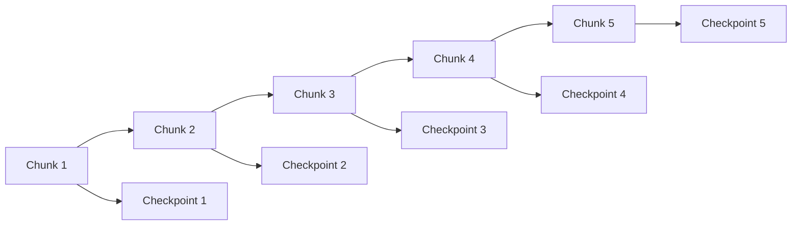
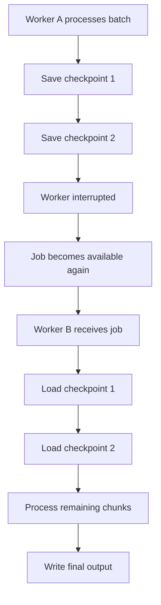
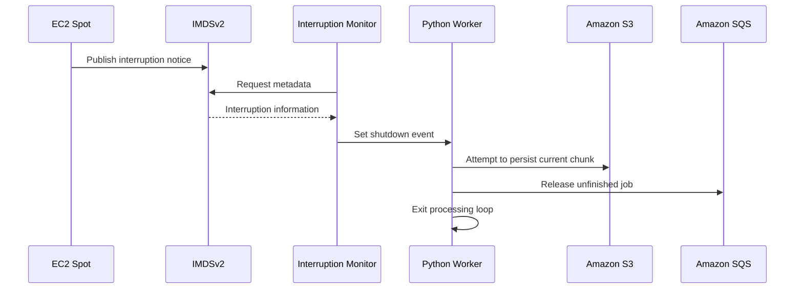
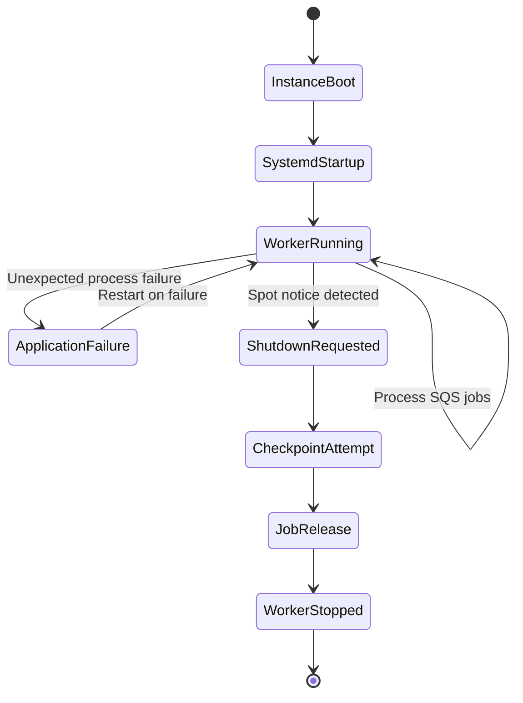
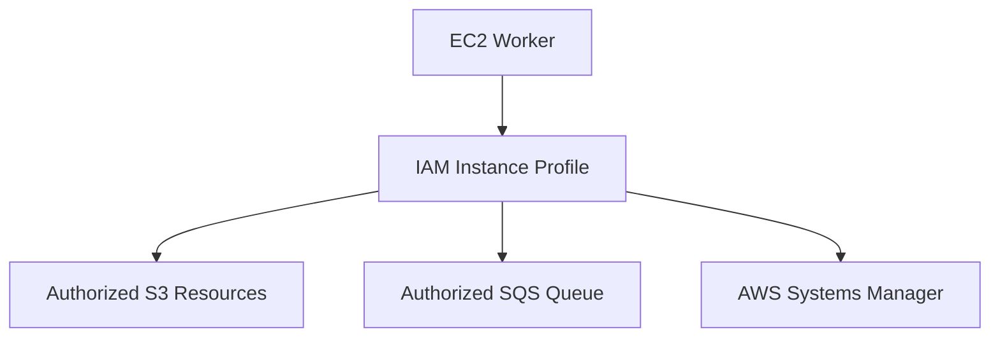
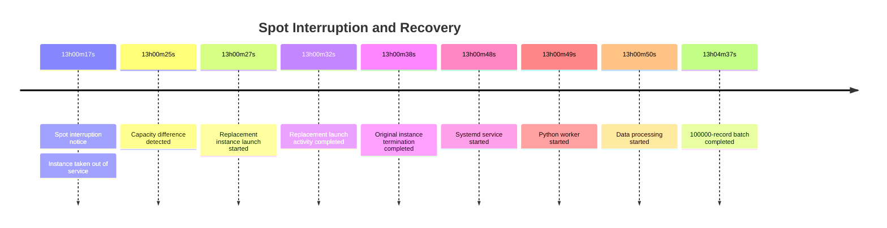

# Fault-Tolerant EC2 Spot Data Processing Pipeline

An event-driven, cost-optimized data processing pipeline built on Amazon EC2 Spot Instances, EC2 Auto Scaling, Amazon S3, Amazon SQS, and AWS Fault Injection Service (FIS).

The project explores how interruptible compute infrastructure can be used for batch data processing while maintaining persistent processing state outside the EC2 instance lifecycle.

## 1. Project Overview

Traditional batch processing systems running exclusively on On-Demand instances can result in higher infrastructure costs.

EC2 Spot Instances offer an alternative by providing access to spare AWS compute capacity at reduced prices. However, Spot Instances can be interrupted when AWS needs to reclaim that capacity.

This project addresses that architectural challenge through:

- Mixed On-Demand and Spot compute capacity
- Multi-Availability Zone deployment
- Multiple eligible EC2 instance types
- Persistent S3-based checkpointing
- SQS-based asynchronous job distribution
- Spot interruption monitoring through IMDSv2
- Automatic instance replacement
- Deterministic output paths
- Controlled fault injection experiments

## 2. Architecture



## 3. Technology Stack

| Technology | Responsibility |
|---|---|
| Amazon EC2 | Data processing compute infrastructure |
| EC2 Spot Instances | Cost-optimized interruptible compute |
| EC2 Auto Scaling | Capacity management and instance replacement |
| Amazon Machine Image | Reusable worker environment |
| EC2 Launch Template | Instance configuration |
| Amazon EBS | Instance root storage |
| Amazon S3 | Raw data, checkpoints and processed results |
| Amazon SQS | Asynchronous job distribution |
| AWS IAM | Resource access management |
| AWS Systems Manager | Secure instance access |
| AWS FIS | Controlled Spot interruption experiments |
| IMDSv2 | Spot interruption notification monitoring |
| Amazon CloudWatch | Auto Scaling group metrics |
| Amazon Linux 2023 | Operating system |
| Python | Data generation and processing |
| Boto3 | AWS service integration |
| Requests | Instance metadata communication |
| Systemd | Worker lifecycle management |
| GitHub Codespaces | Development environment |

## 4. Dataset

The project uses a synthetic e-commerce transaction dataset generated with Python.

| Parameter | Value |
|---|---:|
| Number of batches | 10 |
| Records per batch | 100,000 |
| Total generated records | 1,000,000 |
| Chunk size | 20,000 |
| Chunks per batch | 5 |
| Total chunks per dataset | 50 |
| Simulated processing delay per chunk | 45 seconds |
| Data format | JSON |

Each transaction contains:

- Transaction ID
- Customer ID
- Product ID
- Product category
- Quantity
- Unit price
- Geographic region
- Transaction timestamp

The processing worker calculates an additional field:

```text
total_amount = quantity * unit_price
```

Decimal arithmetic is used during the calculation before the result is serialized into JSON.

The processing delay is intentionally introduced to create a sufficiently long execution window for interruption experiments. It does not represent an actual computational performance benchmark.

## 5. Data Processing Workflow



The SQS message is deleted only after the worker successfully writes the processed output.

If processing fails before message deletion, the message can become available again after its visibility timeout expires.

## 6. S3 Storage Architecture

The pipeline separates persistent data from temporary compute infrastructure.

```text
S3 Bucket
|
|-- raw/
|   |-- batch_0001.json
|   |-- batch_0002.json
|   |-- ...
|
|-- checkpoints/
|   |-- batch_0001/
|   |   |-- chunk_0001.json
|   |   |-- chunk_0002.json
|   |   |-- ...
|   |
|   |-- batch_0002/
|       |-- ...
|
|-- processed/
    |-- batch_0001.json
    |-- batch_0002.json
    |-- ...
```

| Prefix | Purpose |
|---|---|
| raw/ | Original transaction batches |
| checkpoints/ | Persisted chunk-level processing results |
| processed/ | Completed batch outputs |

Storing checkpoints in S3 allows processing state to survive the termination of individual EC2 instances.

The architecture treats EC2 instances as replaceable compute resources rather than permanent data storage systems.

## 7. Event-Driven Job Distribution

Amazon S3 automatically publishes an event notification to Amazon SQS whenever a matching JSON object is created.

Event notification configuration:

| Parameter | Value |
|---|---|
| Event type | All object creation events |
| Object prefix | raw/ |
| Object suffix | .json |
| Destination | Amazon SQS |

SQS configuration:

| Parameter | Value |
|---|---|
| Queue type | Standard |
| Visibility timeout | 300 seconds |
| Message retention | 4 days |
| Delivery delay | 0 seconds |
| Long polling | 20 seconds |
| Encryption | SSE-SQS |
| Dead-letter queue | Not configured |

Workers independently poll the queue and receive processing jobs.

This decouples data ingestion from compute execution and allows multiple EC2 instances to process different batches concurrently.

## 8. Mixed Instances Auto Scaling

The Auto Scaling Group combines On-Demand and Spot Instances within the same worker fleet.



### Capacity Configuration

| Parameter | Value |
|---|---:|
| Minimum capacity | 1 |
| Desired capacity | 3 |
| Maximum capacity | 3 |
| On-Demand base capacity | 1 |
| On-Demand percentage above base | 0% |
| Spot percentage above base | 100% |
| Capacity Rebalancing | Enabled |
| Health check type | EC2 |

### Eligible Instance Types

| Instance Type | vCPU | Memory |
|---|---:|---:|
| t3.micro | 2 | 1 GiB |
| t3a.micro | 2 | 1 GiB |
| t3.small | 2 | 2 GiB |
| t3a.small | 2 | 2 GiB |

Multiple eligible instance types provide additional capacity alternatives when individual Spot capacity pools are unavailable.

The observed three-instance fleet used t3.micro instances.

### Allocation Strategies

**On-Demand: Prioritized**

The Auto Scaling Group uses the configured instance type priority when selecting On-Demand capacity.

**Spot: Price Capacity Optimized**

The allocation strategy considers Spot capacity availability and price when selecting eligible capacity pools.

### Multi-AZ Deployment

The worker fleet was deployed across three Availability Zones in the Frankfurt region:

- eu-central-1a
- eu-central-1b
- eu-central-1c

The intended purchase distribution was successfully established after updating the Auto Scaling Group through AWS CLI.

## 9. Custom AMI and Launch Template

A reusable Amazon Machine Image was created from a temporary builder instance.

The image contained:

- Amazon Linux 2023
- Python runtime
- Python virtual environment
- Boto3 and Requests
- Worker source code
- Checkpoint management module
- Spot interruption monitoring module
- Enabled Systemd service



The builder instance was terminated after the AMI became available.

### Launch Template Configuration

| Parameter | Value |
|---|---|
| Operating system | Amazon Linux 2023 |
| Architecture | x86-64 |
| Default instance type | t3.micro |
| Root volume | 10 GiB gp3 |
| Provisioned IOPS | 3000 |
| Throughput | 125 MiB/s |
| EBS encryption | Enabled |
| Delete on termination | Enabled |
| CPU credit specification | Standard |
| Metadata service | IMDSv2 |
| SSH key pair | Not configured |
| Public IPv4 | Enabled |
| Security group inbound rules | None |

Public IPv4 connectivity was selected for this temporary laboratory environment to avoid introducing NAT Gateway infrastructure.

The purchase model and alternative instance types are managed at the Auto Scaling Group level rather than being fixed in the Launch Template.

## 10. Checkpointing Strategy

Each batch is divided into five chunks containing 20,000 records.

After processing a chunk, the worker persists its result to S3.



### Intended Recovery Behavior



When a worker receives a batch, it checks whether each chunk has already been processed.

Existing checkpoint results are loaded instead of recalculating the corresponding chunk.

Checkpoint creation was observed during the experiment. Recovery from an existing checkpoint was implemented but was not conclusively demonstrated during the interruption test.

## 11. Spot Interruption Handling

A background Python thread monitors the EC2 Instance Metadata Service.

Metadata endpoint:

```text
http://169.254.169.254/latest/meta-data/spot/instance-action
```

The monitoring module:

1. Requests an IMDSv2 session token.
2. Queries the Spot interruption metadata endpoint.
3. Repeats the check at approximately five-second intervals.
4. Sets a shared shutdown event when an interruption notice is detected.



This diagram represents the intended application behavior.

The worker attempts to complete its current chunk and persist the checkpoint before releasing unfinished work.

The SQS message visibility timeout is also extended during processing to reduce the risk of premature message redelivery.

The application-level interruption detection and graceful shutdown sequence were not directly observed during the completed FIS experiment.

## 12. Idempotency Considerations

The worker uses deterministic checkpoint and output object keys.

```text
raw/batch_0001.json

checkpoints/batch_0001/chunk_0001.json

processed/batch_0001.json
```

Repeated processing of the same batch targets the same output location rather than generating arbitrary duplicate output files.

This provides limited object-level idempotency under the assumption that input batches are immutable and uniquely named.

However, Amazon SQS Standard queues provide at-least-once delivery.

The current implementation does not provide:

- Exactly-once processing
- Distributed locking
- Atomic checkpoint coordination
- Concurrent duplicate message protection
- Transactional coordination between S3 and SQS

These limitations are important considerations for a production implementation.

## 13. Worker Lifecycle Management

Systemd manages the Python worker process.



The service uses:

```ini
Restart=on-failure
RestartSec=5
```

This configuration allows Systemd to restart the worker after an unexpected process failure without automatically restarting it after a normal exit.

Automatic worker initialization was observed on the replacement EC2 instance during the experiment.

## 14. Security Architecture

The pipeline uses IAM roles instead of storing permanent AWS credentials inside the application.

Security controls include:

- EC2 IAM instance profile
- Resource-scoped IAM permissions
- S3 public access blocking
- S3 server-side encryption
- SQS server-side encryption
- EBS encryption
- IMDSv2
- No inbound Security Group rules
- AWS Systems Manager Session Manager
- Non-root application execution
- Exclusion of local datasets and environment files from Git



The infrastructure configuration files use placeholders instead of publishing AWS account-specific resource identifiers.

## 15. AWS Fault Injection Service Experiment

AWS Fault Injection Service was used to initiate a controlled interruption of a running Spot Instance.

The experiment evaluated the infrastructure's response to the loss of an interruptible worker.

### Experiment Objectives

- Trigger a controlled Spot interruption.
- Observe instance termination.
- Observe automatic capacity replacement.
- Confirm automatic worker initialization.
- Observe continued data processing.
- Attempt to validate checkpoint recovery.
- Attempt to observe graceful application shutdown.

### Observed Experiment Timeline

Date: November 26, 2026

All timestamps below are UTC.



### Recovery Measurements

| Metric | Observed Value |
|---|---:|
| Replacement launch activity duration | 5 seconds |
| Interruption notice to launch completion | 15 seconds |
| Interruption notice to worker startup | 32 seconds |
| Interruption notice to processing startup | 33 seconds |
| Replacement worker completed batch | 100,000 records |

These measurements were calculated from the Auto Scaling activity history and replacement worker's Systemd journal.

They represent one controlled laboratory experiment and should not be interpreted as guaranteed recovery times.

### Experiment Result

The FIS experiment reached the Completed state.

The interrupted Spot Instance was terminated, and the Auto Scaling Group launched a replacement instance to restore the desired capacity.

The replacement worker automatically started and successfully completed a 100,000-record batch.

The interrupted worker's application logs were not captured because live monitoring was attached to a different instance.

Consequently, application-level interruption detection, graceful shutdown, and checkpoint-based recovery could not be conclusively verified.

## 16. Validation Results

| Capability | Result |
|---|---|
| Synthetic dataset generation | Verified |
| S3 event-driven ingestion | Verified |
| SQS job distribution | Verified |
| Parallel EC2 worker execution | Verified |
| Mixed On-Demand and Spot capacity | Verified |
| Three-AZ deployment | Verified |
| Automatic worker initialization | Verified |
| Chunk-level checkpoint creation | Verified |
| Controlled FIS Spot interruption | Verified |
| Automatic instance replacement | Verified |
| Continued data processing | Verified |
| Checkpoint-based recovery | Implemented, not verified |
| Application interruption detection | Implemented, not verified |
| Graceful application shutdown | Implemented, not verified |
| Record-level data integrity | Not verified |
| Exactly-once processing | Not implemented |
| Actual cost savings | Not measured |

The initial processing run produced ten output files in S3.

A second processing run reused the dataset under new batch names to avoid reusing the original checkpoints.

The complete record-level integrity of both runs was not independently validated.

## 17. Cost Optimization Strategy

The project uses several architectural decisions intended to reduce infrastructure costs.

| Strategy | Purpose |
|---|---|
| Spot Instances | Reduce additional compute capacity costs |
| One On-Demand base instance | Maintain baseline processing capacity |
| Multiple instance types | Increase eligible Spot capacity alternatives |
| Price Capacity Optimized allocation | Balance Spot price and capacity considerations |
| Standard CPU credits | Avoid Unlimited-mode surplus credit charges |
| Small gp3 volumes | Limit root storage requirements |
| Temporary public IPv4 connectivity | Avoid NAT Gateway infrastructure |
| No load balancer | Avoid unnecessary network infrastructure |
| Resource cleanup | Avoid ongoing laboratory resource charges |

The intended fleet composition was:

```text
On-Demand: 1 instance (33.3%)
Spot:      2 instances (66.7%)
```

Actual AWS billing data was not collected. Therefore, the project demonstrates a cost-optimization architecture rather than a measured financial savings result.

## 18. Repository Structure

```text
aws-ec2-spot-data-processing-pipeline/
|
|-- src/
|   |-- generate_data.py
|   |-- worker.py
|   |-- checkpoint.py
|   |-- interruption.py
|
|-- infrastructure/
|   |-- iam-policy.json
|   |-- ec2-trust-policy.json
|   |-- sqs-resource-policy.json
|   |-- sqs-attributes.json
|   |-- s3-event-notification.json
|   |-- mixed-instances-policy.json
|   |-- auto-scaling-group.json
|   |-- spot-data-pipeline.service
|   |-- user-data.sh
|   |-- fis-experiment-template.json
|
|-- requirements.txt
|-- .gitignore
|-- LICENSE
|-- README.md
```

### Application Modules

| File | Responsibility |
|---|---|
| generate_data.py | Synthetic transaction generation |
| worker.py | SQS consumption and batch processing |
| checkpoint.py | S3 checkpoint persistence and retrieval |
| interruption.py | IMDSv2 interruption monitoring |

### Infrastructure Configuration

The infrastructure directory contains reconstructed configuration templates based on the laboratory deployment.

These files are intended as architectural references rather than a complete Infrastructure as Code deployment.

Account-specific placeholders must be replaced before use.

The FIS template is a reference configuration and was not independently deployed from this repository.

The user-data script provides an optional service initialization approach. The actual experiment used a Custom AMI containing an enabled Systemd service.

## 19. Reproduction Guide

### Prerequisites

- AWS account
- AWS CLI
- Git
- Python
- Appropriate IAM permissions
- GitHub Codespaces or a local development environment

### Clone the Repository

```bash
git clone https://github.com/MrEktirir/aws-ec2-spot-data-processing-pipeline.git

cd aws-ec2-spot-data-processing-pipeline
```

### Generate the Dataset

```bash
python src/generate_data.py
```

### Infrastructure Deployment

1. Create an S3 bucket.
2. Create an SQS Standard queue.
3. Configure the SQS resource policy.
4. Configure S3 event notifications.
5. Create the worker IAM policy.
6. Create the EC2 IAM role and instance profile.
7. Attach AmazonSSMManagedInstanceCore to the worker role.
8. Create a temporary EC2 builder instance.
9. Install Python, Git and application dependencies.
10. Configure the Systemd worker service.
11. Stop the builder and create a Custom AMI.
12. Terminate the builder after the AMI becomes available.
13. Create an EC2 Launch Template.
14. Create a Mixed Instances Auto Scaling Group.
15. Configure On-Demand and Spot allocation strategies.
16. Configure the FIS experiment and its required IAM permissions.
17. Start the worker fleet.
18. Upload the generated data to S3.
19. Observe checkpoint creation and data processing.
20. Initiate a controlled Spot interruption.
21. Observe instance replacement and application behavior.
22. Validate results and remove laboratory resources.

For a stronger interruption experiment, attach live monitoring to the exact target instance before initiating the interruption.

## 20. Limitations and Future Improvements

The project is an experimental data engineering laboratory rather than a production-ready deployment.

Potential improvements include:

- Terraform-based infrastructure provisioning
- Persistent centralized application logging
- CloudWatch alarms and dashboards
- SQS dead-letter queue
- Automated record-level integrity validation
- Distributed checkpoint coordination
- Stronger idempotency guarantees
- Graceful SIGTERM handling
- EC2 rebalance recommendation monitoring
- Continuous message visibility heartbeat
- Streaming JSON processing
- Memory and CPU profiling
- Automatic backlog-based scaling
- Private subnet deployment
- Dependency version pinning
- Migration to a supported Python runtime
- Automated cost and performance benchmarking
- Repeated fault injection experiments

The current checkpoint implementation assumes immutable input files with unique batch names.

The worker loads complete JSON batches into memory, which may limit its suitability for substantially larger datasets.

The experiment used Python 3.9 and produced a Boto3 runtime support warning.

A production deployment should address these limitations before processing critical workloads.

## 21. Resource Cleanup

The temporary AWS infrastructure was removed after the experiment using an AWS CloudShell cleanup script.

The cleanup targeted:

- Auto Scaling Group
- Worker EC2 instances
- Launch Template
- Custom AMI
- Associated EBS snapshots
- S3 bucket and objects
- SQS queue
- Project Security Group
- Worker IAM role
- Worker instance profile
- Custom IAM policy
- FIS experiment template
- Experiment-specific IAM role

Cleanup completion was reported after executing the script.

AWS billing records and the complete account inventory were not independently audited.

## 22. Learning Outcomes

This project provided hands-on experience with:

- EC2 Spot Instance lifecycle management
- Mixed Instances Auto Scaling Groups
- On-Demand base capacity configuration
- Spot allocation strategies
- Multi-AZ compute deployment
- Capacity Rebalancing configuration
- Custom AMI creation
- Launch Template management
- Event-driven data processing
- Asynchronous job distribution
- Persistent checkpoint architecture
- IMDSv2 interruption monitoring
- Systemd process management
- AWS Fault Injection Service
- Infrastructure-level fault recovery
- Cost-aware cloud architecture
- IAM-based application security
- AWS CLI infrastructure management
- Temporary cloud resource lifecycle management

## 23. License

This project is licensed under the MIT License.

